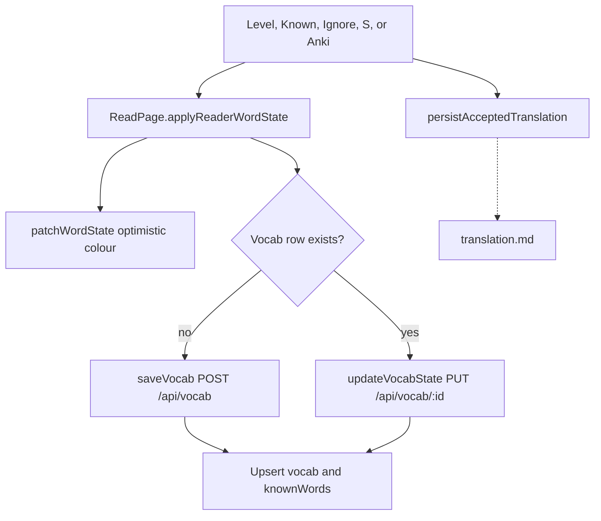

# Vocabulary domain

This domain stores entries that the user owns. It also stores the known-word map. The reader uses `knownWords` for colour. The vocab list uses `vocab`. A save writes both.

## Save vocab and set word state

**App domain:** Vocabulary

There is no Save button. A level, Known, Ignore, keyboard `S`, or Add to Anki creates or updates a row.

Keyboard: `K` marks Known. Keys `1` to `4` set levels. `X` marks Ignore. IME compose skips these keys.

### Key files

| Role | Path | Function |
| --- | --- | --- |
| Reader | `src/app/read/[bookId]/page.tsx` | `setWordLevel`, `markAsKnown`, `ignoreWord`, `saveWordToVocab`, `applyReaderWordState` |
| Colour | `src/components/MarkdownReader/optimistic-word-state.ts` | `patchWordState` |
| Client | `src/lib/data-layer.ts` | `saveVocab`, `updateVocabState`, `getVocabByText` |
| API | `api/src/routes/vocab.ts` | `POST /`, `PUT /:id` |
| Fold | `src/lib/languages.ts` | `foldWord` |

`POST /api/known-words` is not on the drawer path. The reader colours from `GET /api/known-words` at lesson load, then from the optimistic map.

Ignore does not write the translation cache. Known and levels do, for single words with no dict hit. See [translation.md](translation.md#cache-accepted-translation).

Practice mastery 100 calls `updateWordState` in `persistReview`. That is `POST /api/known-words`.

### Word states

`new`, `level1`, `level2`, `level3`, `level4`, `known`, `ignored`.

### Tables

`vocab`, `knownWords`, `dailyStats` (`newWordsSaved`, `wordsMarkedKnown`).

## Vocab list

**App domain:** Vocabulary

| Role | Path | Function |
| --- | --- | --- |
| Page | `src/app/vocab/page.tsx` | `loadData`, `handleUpdateEntry`, `handleDeleteEntry` |
| List | `src/components/VocabList/index.tsx` | `VocabList` |
| Modal | `src/app/vocab/components/VocabDetailModal.tsx` | `handleSave` |
| Client | `src/lib/data-layer.ts` | `getAllVocab`, `updateVocabEntry`, `deleteVocabEntry` |
| API | `api/src/routes/vocab.ts` | `GET /`, `PUT /:id`, `DELETE /:id` |

Filter and page run in memory. `GET /api/vocab` has no `limit`. Delete of the last vocab row for a folded key also deletes `knownWords`.

Tests: `e2e/vocab-edit.spec.ts`, `e2e/vocab-pagination.spec.ts`.

## Mark remaining as known

**App domain:** Vocabulary

The reader header and listen-along have a `Mark remaining as known` control. It collects the unique tappable words in the lesson. It keeps only words with no state or the state `new`. The learner confirms the count. The write changes `knownWords` only, so it creates no `vocab` rows. There is no undo.

The collector reads paragraphs and list items only, because `ReaderArticle` makes only those tappable. It does not read headings, link targets, or image sources. The control is disabled when no words remain, or when the lesson language is not the active language.

| Role | Path | Function |
| --- | --- | --- |
| UI | `src/components/MarkRemainingKnown/index.tsx` | `MarkRemainingKnown` |
| Reader | `src/app/read/[bookId]/page.tsx` | `markRemainingKnown` |
| Collect | `src/components/MarkdownReader/remaining-words.ts` | `tappableMarkdownText`, `uniqueWordKeys`, `remainingWordKeys` |
| Optimistic map | `src/components/MarkdownReader/optimistic-word-state.ts` | `patchWordStates` |
| Client | `src/lib/data-layer.ts` | `bulkUpdateWordStates` |
| API | `api/src/routes/known-words.ts` | `POST /` |

A failed write restores the earlier colours. On success, `dailyStats.wordsMarkedKnown` grows by the word count.

Tests: `e2e/reader-mark-remaining-known.spec.ts`.

## Known-word import

**App domain:** Vocabulary

Settings, Import Known Words. A plain list writes `knownWords` only. A LingQ CSV also writes `vocab`.

A LingQ CSV can use the LingQ export columns: `term`, `phrase`, and `meaning1` to `meaningN`. It can also use the columns `term`, `hint`, `status`, and `sentence`. The `phrase` column or the `sentence` column gives the sentence. A row without `status` gets `level1`. If the word is already in `vocab`, the import fills only an empty translation or sentence. It does not lower the state.

| Role | Path | Function |
| --- | --- | --- |
| UI | `src/app/settings/components/KnownWordsImport/index.tsx` | `importKnownWords`, `importLingQWords` |
| Parse | `src/app/settings/components/KnownWordsImport/utils.ts` | `parseCSV`, `parseLingQExport`, `lingqStatusToState` |
| Client | `src/lib/data-layer.ts` | `bulkUpdateWordStates`, `saveVocab`, `updateVocabEntry` |
| API | `api/src/routes/known-words.ts` | `POST /` |

New rows have `domain IS NULL` until the classifier runs. See [stats.md](stats.md).
